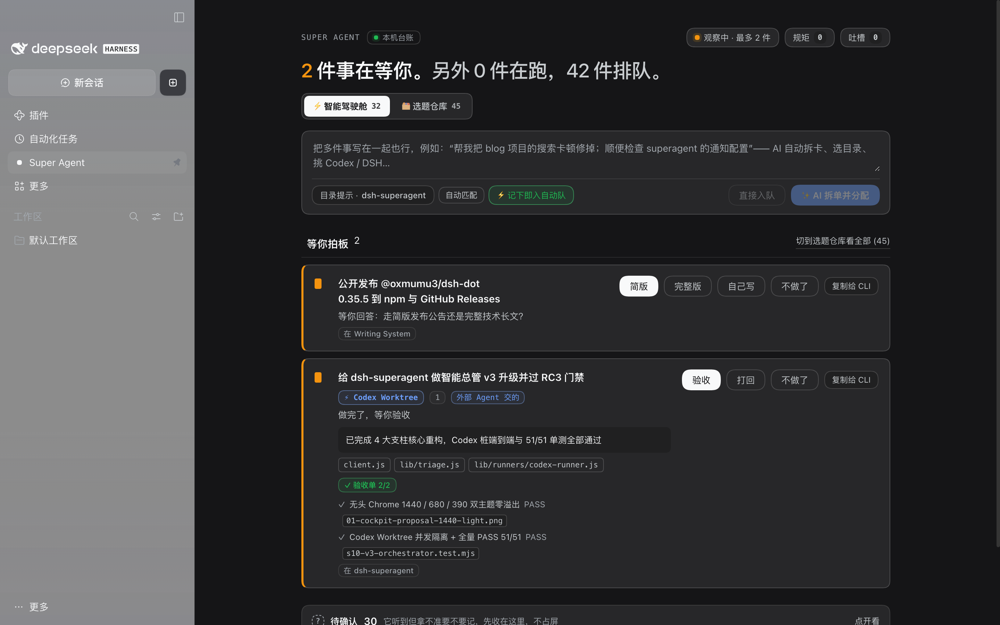
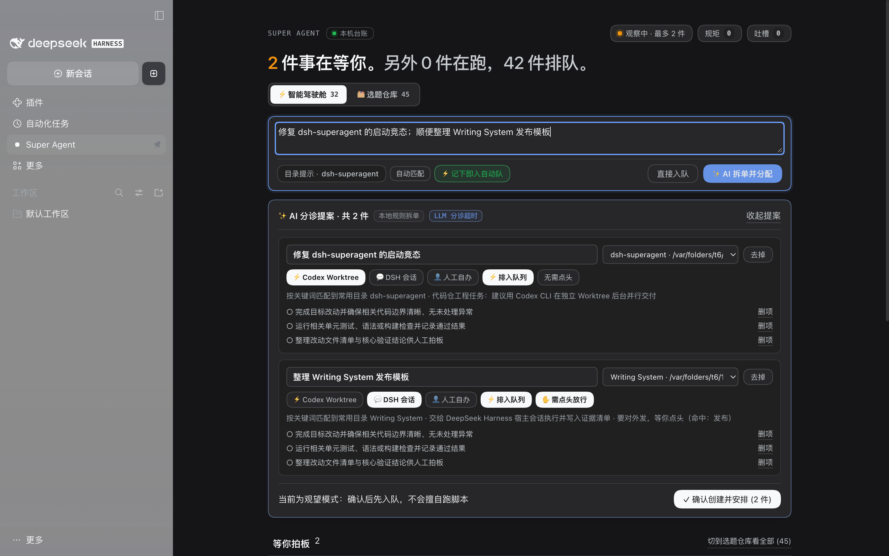
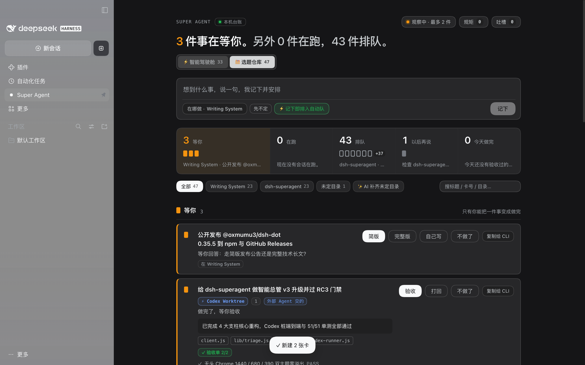

# Super Agent (@oxmumu3/dsh-superagent)

**DeepSeek Harness 原生智能任务总管：你只管用大白话甩需求和最后拍板，中间的拆卡、找目录、并发施工和交活汇总全交给它。**

> 作者：`牛村木木山 <157776623+oxmumu3@users.noreply.github.com>` · 协议：`MIT` · 适用宿主：`DeepSeek Harness >=0.2.2-rc.2 <0.3.0`（macOS）  
> 这是一个跑在 **DeepSeek Harness 桌面端内部** 的社区开源插件，**不是** DeepSeek 官方产品，也不是脱离桌面宿主的独立命令行工具。

## 安装方式

1. 在 DeepSeek Harness 新建会话，点顶部「标准模式」下拉，切到「创造模式」。
2. 复制下面这句话发给 Agent，弹出授权时点「允许」：

```text
请通过插件管理器，从 npm 官方源安装并启用 @oxmumu3/dsh-superagent@latest。完成后请核对版本和启用状态，再带我打开左侧「Super Agent」。
```

（也可以在「插件 -> 添加插件」直接填入 `@oxmumu3/dsh-superagent@latest` 安装并启用；如需离线包或备用下载，也可在 [GitHub Releases](https://github.com/oxmumu3/dsh-superagent/releases) 获取 `.tgz` 后通过「插件 -> 添加插件」安装。）

开源仓库与图文说明（觉得有帮助欢迎点个 Star）：  
<https://github.com/oxmumu3/dsh-superagent>

## 界面与核心能力一览（v0.3.0）

### 1. ⚡ 智能驾驶舱 + 🗂 选题仓库双视图：不再用几十条待办糊你一脸

- **默认进「⚡ 智能驾驶舱」**：首页只保留顶部派活框和**真正需要你拍板的事**（做完了等你验收、卡住了问你选方案、涉及敏感外发等你点头），默认折起后台低优「待确认」列表。
- **按需切「🗂 选题仓库」**：所有历史卡片、5 组全景、搜索与目录筛选、吸顶分组页签全部收纳在这里，随时切换对照。



### 2. ✨ 一句话 AI 拆单分诊：自动配真实目录、起草验收清单、敏感动作挂点头锁

- 把好几件事混在一句话里直接丢进输入框（例如 *「修复某项目启动竞态；顺便整理另一项目发布模板」*），点击 **「✨ AI 拆单并分配」**，先生成可修改的**分诊提案卡**：
  - **自动拆单 & 真实目录防幻觉**：结合宿主工作区列表与已有任务路径匹配目标目录，严禁模型凭空编造不存在的路径；
  - **推荐执行工人 & 起草验收清单**：按是否为 Git 代码仓与本机 `codex` 可用性推荐 **Codex Worktree** 或 **DSH 会话**，自动生成 2–3 条可核验清单；
  - **风险点头锁**：命中发布、删除、外发、支付等风险关键词时自动标为 **✋ 需点头放行**，绝不先斩后奏；
  - **老卡片一键整理**：在选题仓库点击 **「✨ AI 补齐未定目录」** 即可批量补全历史空白目录，附带 Toast 一键撤销快照。



### 3. 🛠 Codex CLI + Git Worktree 并发施工与证据验收闭环

- **独立 Worktree 副本施工**：对 Git 代码仓的 Codex 任务自动创建独立 Git Worktree 分支工位并发推进；同一代码仓下的多个 Codex Worktree 任务自动豁免同目录串行等待，互不污染工作区。
- **结构化交活 & 打回续跑**：工人完成时经 JSON Schema / CLI 结构化回填摘要、改动文件与验收单检查结果；点 **「打回」** 可附原因（并勾选保存为该工作区的长期验收规矩），触发 原 Worktree `codex exec resume` 续改；点 **「验收」** 后自动清理临时 Worktree。
- **桌面静默防打扰提醒**：仅在真实非沙箱运行环境自动探测本机 `dsh-wechat`，在需要人工拍板或验收时投递提醒，隔离测试零误发。



## 它做什么 & 不做什么

- **默认只记明确指令**：在普通对话收到用户来源消息时，只响应句首明确的 `记一下：…`、`放到待办：…` 等指令或面板内主动操作；不把普通聊天内容私自建卡或塞给外部分类器。
- **权限边界清晰**：默认处于观望/可控模式，不会替人绕过宿主工具权限审批；遇到「✋ 需点头放行」卡片必须人工确认后才继续调度。
- **兼容既有数据与契约**：保留全部既有台账格式与 S0–S9 工具契约（`sa_list` / `sa_get` / `sa_create` / `sa_move` / `sa_comment` / `sa_report` / `sa_check` / `sa_checklist` / `sa_depend` / `sa_dispatch`），卸载或升级均不删除 `~/.dsh/superagent-ledger.json` 任务台账。

<details>
<summary>开发者与本地验证说明（测试 / 确定性打包 / 许可）</summary>

### 本地测试（零外部依赖，Node.js >= 22）

```sh
node scripts/check-client.cjs
node scripts/run-tests.mjs
```

所有测试均在临时台账目录中运行，不读写 `~/.dsh/superagent-ledger.json`、不修改日常桌面配置、不向外发真实消息。

### 构建确定性安装包

```sh
node scripts/build-preview-package.mjs --out dist
```

构建脚本仅按 `package.json` 的 `files` 白名单打包并固定 mtime / uid / gid 与文件排序，连续两次构建产出完全一致的 SHA-256。正式发布以 GitHub Actions 工作流经 npm Trusted Publisher 产出的签名包及 SHA-256 回执为准。

### 开源许可

[MIT](LICENSE) · 版权归牛村木木山。

</details>
